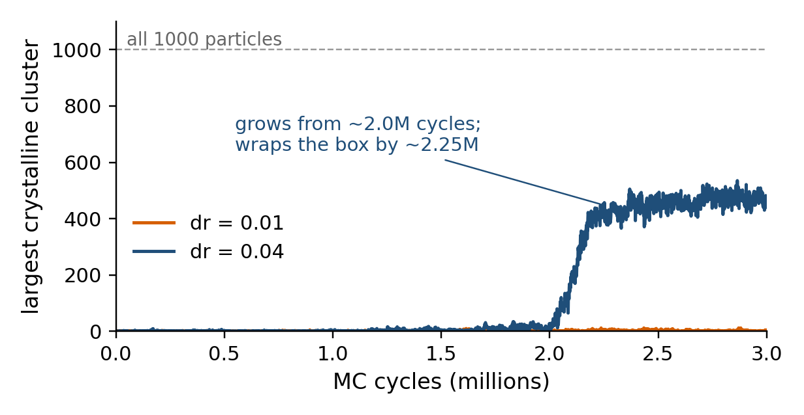

# Crystal nucleation in oppositely charged colloids: Monte Carlo replication at p* = 18

Replication attempt of **Sanz, Valeriani, Frenkel, Dijkstra, "Evidence for Out-of-Equilibrium Crystal Nucleation in
Suspensions of Oppositely Charged Colloids", Phys. Rev. Lett. 99, 055501 (2007)** using brute-force NpT Monte Carlo
of a binary mixture of oppositely charged hard-core Yukawa particles. No forward-flux sampling (FFS) and no swap
moves were used.

> **Status (2026-11):** one working Monte Carlo code, a validated liquid starting state and two 3-million-cycle
> no-swap campaigns at p\* = 18. A close-packed crystal formed in one of the two runs. Next steps and open
> questions are in [docs/NEXT_STEPS.md](docs/NEXT_STEPS.md).
> This repository is **private** and shared for review; see [Credits and licence](#credits-and-licence).

## What was found (short version)

| Run (N = 1000, T\* = 1, p\* = 18, κσ = 6, no swaps) | Max. particle step dr | Outcome after 3×10⁶ MC cycles |
|---|---|---|
| Control | 0.01 | stays liquid (largest crystalline cluster ≤ 12 particles) |
| Comparison | 0.04 | crystal appears at about 2.0–2.25×10⁶ cycles, then fills and wraps the box (440 crystalline particles by CNA at the end: 146 fcc, 294 hcp, 8 bcc) |

* The crystal is **close-packed (fcc/hcp, stacking disorder)** with almost no bcc, so it is **not CsCl**.
* The fraction of opposite-charge nearest neighbours inside the crystal is 0.58, against 0.60 in the liquid
  (random mixing: 0.50), so there is **no extra charge order**: consistent with the paper's "substitutionally
  disordered fcc" for runs without swaps.
* **Caveats:** one trajectory per setting, so no rate. The crystal wraps the 1000-particle periodic box
  from about 2.2×10⁶ cycles, so its final size is limited by the box; quote the **nucleation time, not a nucleus size**.
  The paper gives no cluster size, time or step size at p\* = 18, so the comparison is qualitative.



## Where to start

1. **New to the project?** Read [docs/PROJECT_MAP.md](docs/PROJECT_MAP.md). It says what every folder holds and
   which file answers which question.
2. **The paper in plain language:** [docs/reports/01_paper_manual.pdf](docs/reports/01_paper_manual.pdf).
3. **What was done and what came out:** [docs/reports/05_meeting_report.pdf](docs/reports/05_meeting_report.pdf)
   and the three slides [docs/reports/07_meeting_slides.pptx](docs/reports/07_meeting_slides.pptx).
4. **How the story unfolded:** [docs/HISTORY.md](docs/HISTORY.md).
5. **Run something yourself:** [docs/REPRODUCE.md](docs/REPRODUCE.md).

## Quick start (about 10 minutes, no simulation needed)

```bash
git clone https://github.com/raghu-nomula/colloidal_cluster_nucleation.git && cd colloidal_cluster_nucleation
conda env create -f environment.yml && conda activate yukawa-nucleation
python analysis/analyze_example_frames.py        # structure analysis of four saved frames
make                                              # compile the Fortran Monte Carlo code (needs gfortran)
```

`analyze_example_frames.py` should print a table whose last rows read 146 fcc / 302 hcp (2.25M cycles) and
146 fcc / 294 hcp (3.0M cycles), with largest clusters 448 and 440.

## What is in this repository, and what is not

* **In:** Fortran source, run scripts, all input files and run manifests, the written lab notebook of the clean
  replication, analysis scripts, result tables, figures, reports and slides.
* **Not in:** the simulation trajectories (`*.lammpstrj`, 1.67 GB). They are on the owner's PC and are listed with
  sizes and SHA-256 checksums in [docs/DATA.md](docs/DATA.md). **Ask the owner** if you need them. Four example
  frames that suffice for the structure analysis are in [results/example_frames/](results/example_frames/).
* **Not in (copyright):** the paper and reference PDFs, and the book's original code.

## How to suggest changes

Fork, branch, open a pull request; the owner reviews and merges. Details: [CONTRIBUTING.md](CONTRIBUTING.md).
Questions and ideas can also go into GitHub Issues.

## Credits and licence

* Paper being replicated: Sanz, Valeriani, Frenkel, Dijkstra, PRL 99, 055501 (2007).
* The Monte Carlo code was adapted from the NpT case study accompanying *Understanding Molecular Simulation*
  by Daan Frenkel and Berend Smit (Lennard-Jones, converted here to a signed hard-core Yukawa potential with two
  particle types and trajectory output).
* The cluster-size definition of the paper is ref. [18]: P. R. ten Wolde, M. J. Ruiz-Montero, D. Frenkel,
  J. Chem. Phys. 104, 9932 (1996).
* **No licence has been chosen yet** (see [LICENSE](LICENSE)); it depends on the licence of the book code.
* How to cite: [CITATION.cff](CITATION.cff).
